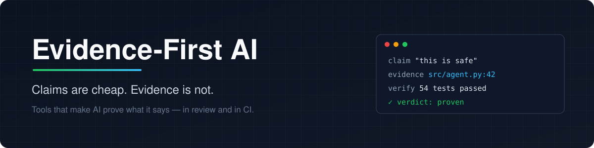
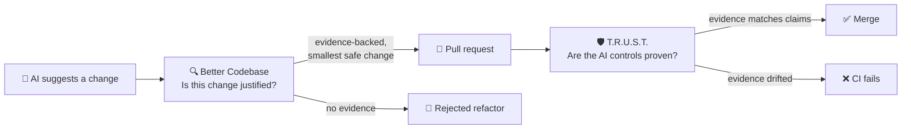

<div align="center">



<br/>

**A collection of open-source tools that refuse to trust AI output without proof.**

[](#-projects)
[](#-the-idea)
[](https://github.com/NicolasYusim)

[The idea](#-the-idea) · [Projects](#-projects) · [How they fit together](#-how-they-fit-together) · [Principles](#-shared-principles)

</div>

---

## 💡 The idea

AI is very good at producing things that *look* right: a confident refactoring
plan, a tidy architecture diagram, a governance doc that says *"high-risk actions
require confirmation"*.

Looking right is not the same as being right.

Every project in this collection is built around one rule:

> **A claim without evidence is not a finding, not a control, and not a reason to change code.**

Each tool takes a plausible AI-era claim and forces it through the same chain:

```text
claim  →  evidence  →  mechanism  →  verification  →  verdict
```

If any link is missing, the claim is rejected — loudly and explicitly.

---

## 📦 Projects

<table>
<tr>
<td width="50%" valign="top">

### 🔍 [Better Codebase](https://github.com/NicolasYusim/better-codebase)

**Codebase review that refuses unjustified refactors.**

Evidence-first code review and refactoring skills for **Claude Code** and
**Codex**. Finds root causes, rejects unnecessary refactors, and proposes the
smallest safe change.

- 🎯 Every finding must cite **evidence, mechanism, impact, intervention, verification**
- 🚫 Explicit list of **rejected refactors** — no layers for the sake of layers
- 🧠 Seven internal reviewers: architecture, simplicity, duplication, maintainability…
- 🧪 Reproducible evals with controlled with/without comparisons

```bash
npx skills add NicolasYusim/better-codebase --skill '*'
```

[](https://github.com/NicolasYusim/better-codebase/stargazers)
[](https://github.com/NicolasYusim/better-codebase/blob/main/LICENSE)
[](https://github.com/NicolasYusim/better-codebase/commits)

**[→ Open repository](https://github.com/NicolasYusim/better-codebase)**

</td>
<td width="50%" valign="top">

### 🛡️ [T.R.U.S.T.](https://github.com/NicolasYusim/TRUST-AI-Engineering)

**Prove your AI controls in CI.**

Policy-as-code for AI engineering evidence. Verifies AI controls, evals,
exceptions, and risk policy on every pull request.

- 📜 Versioned contract (`trust.yaml`) for each AI component
- 🔗 Resolves the **real evidence** behind every declared control
- 📊 Checks that metrics match committed test results and hashes are current
- ⏰ Fails the PR when evidence drifts or an exception expires

```bash
./trust check
```

[](https://github.com/NicolasYusim/TRUST-AI-Engineering/stargazers)
[](https://github.com/NicolasYusim/TRUST-AI-Engineering/blob/main/LICENSE)
[](https://github.com/NicolasYusim/TRUST-AI-Engineering/commits)

**[→ Open repository](https://github.com/NicolasYusim/TRUST-AI-Engineering)**

</td>
</tr>
</table>

---

## 🧩 How they fit together

The two projects guard the same principle at two different moments of the
software lifecycle:



| | 🔍 Better Codebase | 🛡️ T.R.U.S.T. |
| --- | --- | --- |
| **Distrusts** | AI-generated *advice* about code | Human/AI *claims* about AI components |
| **When** | During review & refactoring | On every PR, in CI |
| **Question** | *"Is this change actually needed?"* | *"Is this control actually enforced?"* |
| **Evidence** | `file:line`, root cause, reproduction | Implementation, tests, hashes, metrics |
| **Output** | Ranked findings + rejected refactors | Pass / fail CI decision |
| **Restraint** | Smallest safe change | No claim beyond what evidence proves |

---

## 📐 Shared principles

<table>
<tr>
<td align="center" width="25%">🔎<br/><b>Evidence over plausibility</b><br/><sub>If it can't be pointed to, it doesn't count.</sub></td>
<td align="center" width="25%">🪶<br/><b>Restraint over activity</b><br/><sub>The best change is often the smallest — or none.</sub></td>
<td align="center" width="25%">🧪<br/><b>Verification over trust</b><br/><sub>Every claim ships with a way to prove it.</sub></td>
<td align="center" width="25%">📢<br/><b>Explicit rejection</b><br/><sub>Say what was <i>not</i> done, and why.</sub></td>
</tr>
</table>

---

## 🗺️ Roadmap

New projects join this collection only if they follow the same rule:
**they turn an AI-era claim into something that can be checked.**

- [x] Better Codebase — evidence-first code review
- [x] T.R.U.S.T. — evidence-first AI governance in CI
- [ ] *Next project…*

---

<div align="center">

<sub>Built by <a href="https://github.com/NicolasYusim">@NicolasYusim</a> · If one of these tools saved you from a bad refactor or an unproven claim, a ⭐ on the project helps.</sub>

</div>
